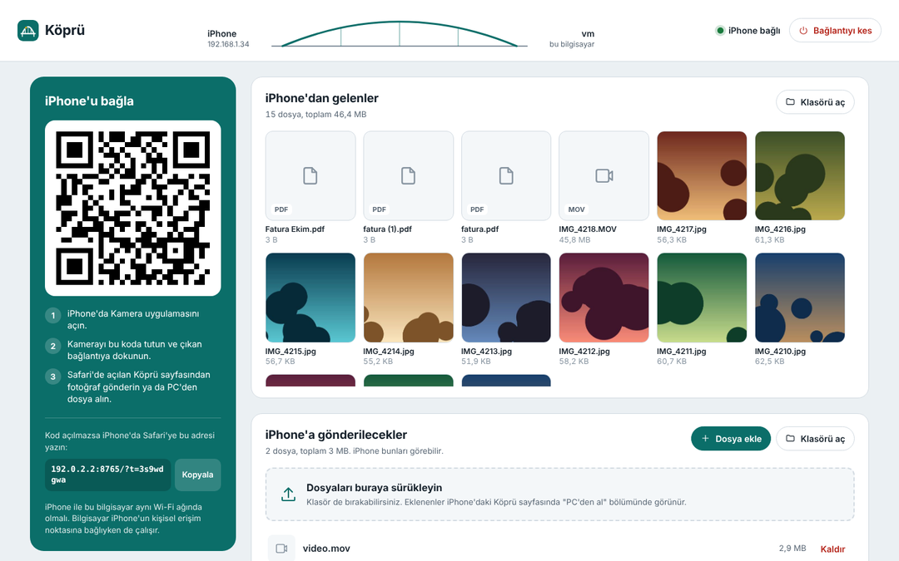
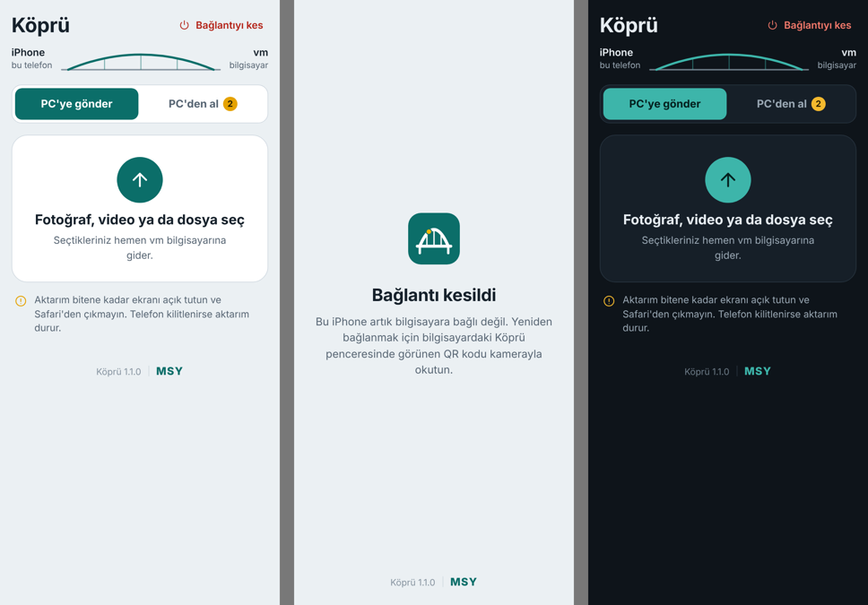

# Köprü

iPhone ile Windows PC arasında Wi-Fi üzerinden iki yönlü fotoğraf, video ve dosya aktarımı.
PC'de tek bir `.exe` çalışır; iPhone tarafı Safari'de açılan bir sayfadır, iPhone'a uygulama kurulmaz.

## İndir

**[Kopru-Windows.zip dosyasını indir](https://github.com/m-salihyuksel/Kopru/releases/latest/download/Kopru-Windows.zip)** (Windows 10 / 11, 64 bit)

ZIP'i bir klasöre çıkarın ve `Kopru.exe`'ye çift tıklayın. Tüm sürümler [Sürümler](https://github.com/m-salihyuksel/Kopru/releases) sayfasında.

- Windows "bilgisayarınızı korudu" derse: **Ek bilgi → Yine de çalıştır**. (Uygulama imzalı olmadığı için bu uyarı çıkar.)
- Güvenlik duvarı sorarsa **Özel ağlar** için izin verin; yoksa iPhone bilgisayara ulaşamaz.





## Kullanım

1. PC'de `Kopru.exe`'yi açın. Tarayıcıda Köprü paneli ve bir QR kod görünür.
2. iPhone'da Kamera'yı açıp QR koda tutun, çıkan bağlantıya dokunun. Safari'de Köprü sayfası açılır.
3. **iPhone → PC:** "PC'ye gönder" ile fotoğraf, video ya da dosya seçin. Gelenler `Köprü\iPhone'dan Gelenler` klasörüne kaydedilir.
4. **PC → iPhone:** Dosyaları paneldeki "iPhone'a gönderilecekler" alanına sürükleyin. iPhone'da "PC'den al" sekmesinde görünür; tek tek ya da toplu ZIP olarak indirilebilir.
5. **Bağlantıyı kes:** iPhone'da sağ üstteki düğme yalnızca o telefonun oturumunu kapatır; QR kodu okutunca yeniden bağlanır. PC panelindeki düğme bağlı iPhone'u hemen düşürür, süren aktarımı durdurur ve yeni bir QR kod oluşturur; eski kod artık çalışmaz.

iPhone ile bilgisayar aynı Wi-Fi ağında olmalı (bilgisayar iPhone'un Kişisel Erişim Noktası'na bağlıyken de çalışır). Dosyalar internete çıkmaz, yalnızca yerel ağda aktarılır. Ayrıntılı kılavuz ve sorun çözme: [docs/Nasıl kullanılır.txt](docs/Nasıl%20kullanılır.txt)

## Nasıl çalışır

- PC'de yerel ağda bir HTTP sunucusu açılır (varsayılan port 8765).
- Panel (`/pc`) yalnızca bilgisayarın kendisinden açılabilir; QR kodu, gelen dosyaları ve gönderilecekleri gösterir.
- iPhone QR koddaki adresi açar. Adresteki erişim anahtarı (`?t=`) olmadan hiçbir sayfa açılmaz; hatalı denemeler IP başına sınırlandırılır.
- Yüklemeler belleğe alınmadan doğrudan diske akar (çok büyük videolar sorun olmaz), bitince `.kopru-part` uzantılı geçici dosya asıl adına taşınır. Aynı adlı dosyalar `ad (1).jpg` olur.
- İndirmeler Range destekler (Safari'de video oynatma ve kaldığı yerden devam), çoklu indirme sıkıştırmasız ZIP olarak akar.
- JPEG/PNG/GIF için küçük önizlemeler üretilir; iPhone fotoğraflarındaki EXIF döndürme uygulanır.

## Kaynaktan derleme

Go 1.22+ gerekir.

```
go test ./...
go build -ldflags "-s -w" -o Kopru.exe .
```

Linux/macOS'tan Windows için:

```
GOOS=windows GOARCH=amd64 CGO_ENABLED=0 go build -trimpath -ldflags "-s -w" -o Kopru.exe .
```

`main` dalına her gönderimde GitHub Actions `.exe`'yi derleyip `main.go` içindeki `appVersion` numarasıyla sürüm sayfasına `Kopru-Windows.zip` olarak ekler. Yeni sürüm için `appVersion`'ı artırmak yeterli.

İkon `rsrc_windows_amd64.syso` dosyasından gelir. Yeniden üretmek için:

```
go install github.com/akavel/rsrc@latest
rsrc -ico winres/icon.ico -manifest winres/kopru.manifest -arch amd64 -o rsrc_windows_amd64.syso
```

| Dosya | İçerik |
|---|---|
| `main.go` | Başlangıç, ayarlar, ikinci kopya kontrolü, konsol çıktısı |
| `server.go` | HTTP uçları, erişim kontrolü, yükleme/indirme/ZIP |
| `session.go` | Bağlantıyı kesme, anahtar yenileme, süren aktarımları durdurma |
| `files.go` | Dosya adı temizleme, listeleme, benzersiz ad ayırma |
| `thumb.go` | Önizleme üretimi ve EXIF döndürme |
| `netinfo.go` | iPhone'un ulaşabileceği yerel IP'nin seçimi |
| `platform_windows.go` | Konsol ayarları, tarayıcı/Gezgin açma |
| `web/` | PC paneli, iPhone sayfası, ortak stil, ikon |
| `kopru_test.go` | Telefondan gelen istekleri taklit eden testler |

---

Geliştiren: **MSY**
